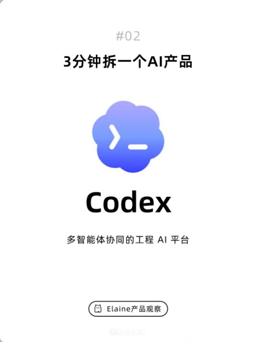

# 每天认识一个AI产品：Codex

[⬅ 返回Elaine主页](./README.md) · [返回对标总览](../README.md) · [小红书原帖链接](https://www.xiaohongshu.com/explore/6a0eed1f00000000070139e3)

---

## 一、基础数据

- **作者**：Elaine产品观察（1319 粉）
- **数据**：6355 赞 · 4427 藏 · 396 评（置顶）
- **时间**：编辑于 07-28
- **形式**：图文（共 6 页）

---

## 二、帖子正文与话题（原文）

> **【待 Codex 补采】**：上次采集未保存正文区原文与 `#话题` 标签，需在本地浏览器打开原帖一字不改粘贴于此。

---

## 三、全部内页原图与图上原文（共 6 页）

| 页码 | 原图 | 图上原始文字（逐字转录） |
|---|---|---|
| **P1** |  | #02 3分钟拆一个AI产品 Codex 多智能体协同的工程 AI 平台 Elaine产品观察 |
| **P2** | *待补 `assets/01/p02.png`* | *【待补图上原文】（旧摘要：产品定位及工程任务场景）* |
| **P3** | *待补 `assets/01/p03.png`* | *【待补图上原文】（旧摘要：按任务隔离、协作、测试与自动化分组介绍能力）* |
| **P4** | *待补 `assets/01/p04.png`* | *【待补图上原文】（旧摘要：云端与本地架构解释）* |
| **P5** | *待补 `assets/01/p05.png`* | *【待补图上原文】（旧摘要：对照其他开发工具的竞品表）* |
| **P6** | *待补 `assets/01/p06.png`* | *【待补图上原文】（旧摘要：总结工作方式变化和未来角色）* |

---

## 四、评论区原始留言摘录

- 「需要一个手把手教的」（共 5 条主评询问安装与手把手使用教程）
