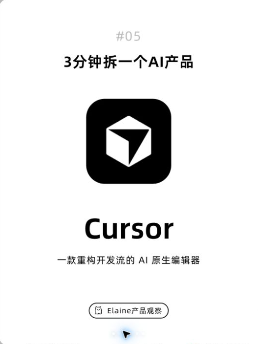

# 每天认识一个AI产品：Cursor

[⬅ 返回Elaine主页](./README.md) · [返回对标总览](../README.md) · [小红书原帖链接](https://www.xiaohongshu.com/explore/6a1ec58a0000000006037914)

---

## 一、基础数据

- **作者**：Elaine产品观察（1319 粉）
- **数据**：951 赞 · 737 藏 · 16 评
- **时间**：编辑于 06-02
- **形式**：图文（共 6 页）

---

## 二、帖子正文与话题（原文）

> **【待 Codex 补采】**：上次采集未保存正文区原文与 `#话题` 标签，需在本地浏览器打开原帖一字不改粘贴于此。

---

## 三、全部内页原图与图上原文（共 6 页）

| 页码 | 原图 | 图上原始文字（逐字转录） |
|---|---|---|
| **P1** |  | 每天认识一个AI产品：Cursor（同系列白底封面） |
| **P2** | *待补 `assets/02/p02.png`* | *【待补图上原文】（旧摘要：产品概述，区分简单外挂 AI 与开发流程变化，列出编码、理解和修改代码场景）* |
| **P3** | *待补 `assets/02/p03.png`* | *【待补图上原文】（旧摘要：功能页介绍补全、对话和上下文）* |
| **P4** | *待补 `assets/02/p04.png`* | *【待补图上原文】（旧摘要：架构页解释编辑器、工具调用和云端等组成）* |
| **P5** | *待补 `assets/02/p05.png`* | *【待补图上原文】（旧摘要：竞品页按多个维度排列工具）* |
| **P6** | *待补 `assets/02/p06.png`* | *【待补图上原文】（旧摘要：总结目标用户和发展判断）* |

---

## 四、评论区原始留言摘录

- 「可以说得再平民化一些」
