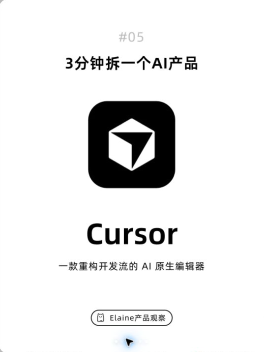

# Elaine产品观察（1319 粉）

[⬅ 返回对标总览](../README.md) · [小红书主页原链](https://www.xiaohongshu.com/user/profile/6a0529580000000002001001)

---

## 一、已归档原帖

| 封面预览 | 标题（点击看原帖） | 赞 / 藏 / 评 | 页数 | 原图与原文状态 |
|---|---|---|---|---|
|  | [01_6355赞_每天认识一个AI产品_Codex](./01_6355赞_每天认识一个AI产品_Codex.md) | 6355 / 4427 / 396（置顶） | 6 页 | 已有封面图；**待补 P2～P6 原图与逐页原文、正文原文** |
|  | [02_951赞_每天认识一个AI产品_Cursor](./02_951赞_每天认识一个AI产品_Cursor.md) | 951 / 737 / 16 | 6 页 | 已有封面图；**待补 P2～P6 原图与逐页原文、正文原文** |
|  | [03_909赞_2026好用的Vibe_Coding工具都在这里啦](./03_909赞_2026好用的Vibe_Coding工具都在这里啦.md) | 909 / 1250 / 6（置顶） | 6 页 | **待补 P1～P6 原图与逐页原文、正文原文** |

---

## 二、主页其他可见笔记列表（2026-11-11 记录）

| 笔记标题 | 赞数 | 链接 |
|---|---:|---|
| 每天认识一个AI产品：Devin Desktop | 127 | https://www.xiaohongshu.com/explore/6a2bd49b0000000007029a37 |
| 每天认识一个AI产品：GitHub Copilot | 92 | https://www.xiaohongshu.com/explore/6a2165010000000006020057 |
| 每天认识一个AI产品：Slack | 60 | https://www.xiaohongshu.com/explore/6a71d8c9000000002701cc74 |
