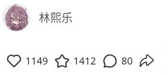
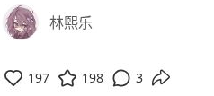
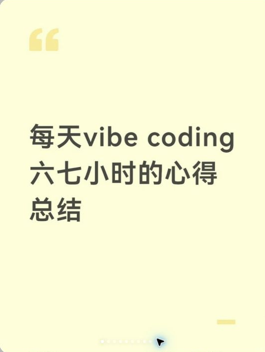

# 每天vibe coding六七小时的心得总结

[⬅ 返回林熙乐主页](./README.md) · [返回对标总览](../README.md) · [版本1原帖(1149赞)](https://www.xiaohongshu.com/explore/6adef93c000000000901b280) · [版本2原帖(197赞)](https://www.xiaohongshu.com/explore/6adeaa1c000000001801ba99)

---

## 一、基础数据

- **作者**：林熙乐（350 粉）
- **版本 1**：标题《每天vibe coding六七小时的心得总结》 · 1149 赞 · 1412 藏 · 80 评 · 编辑于 10-26
- **版本 2（同文另一篇）**：标题《不会vibe coding都给我去看啊啊啊！so easy》 · 197 赞 · 256 藏 · 3 评 · 11-05
- **形式**：图文（共 11 页，两版 P2～P11 内页完全相同）

| 版本 1 数据 | 版本 2 数据 |
|---|---|
|  |  |

---

## 二、帖子正文与话题（原文）

> **【待 Codex 补采】**：上次采集未保存正文区原文与 `#话题` 标签，需在本地浏览器打开原帖一字不改粘贴于此。

---

## 三、全部内页原图与图上原文（共 11 页）

> **【待 Codex 补采 P2～P11】**：上次采集仅保存了 P1 封面图，P2～P11 仅留存了摘要（括号内为旧摘要占位）。请按 `benchmark-collect` SOP 补存 `assets/02/p02.png`～`p11.png` 并替换为图上逐字原文。

| 页码 | 原图 | 图上原始文字（逐字转录） |
|---|---|---|
| **P1（版本1封面）** |  | 每天vibe coding六七小时的心得总结 |
| **P1（版本2封面）** |  | 每天vibe coding 6小时，这是我的完整工作流程 |
| **P2** | *待补 `assets/02/p02.png`* | *【待补图上原文】（旧摘要：工具相同但用法不同，转入个人项目经历）* |
| **P3** | *待补 `assets/02/p03.png`* | *【待补图上原文】（旧摘要：从能运行到修改崩坏的落差，引出需求文档）* |
| **P4** | *待补 `assets/02/p04.png`* | *【待补图上原文】（旧摘要：去 GitHub 看他人工作方式与更新记录）* |
| **P5** | *待补 `assets/02/p05.png`* | *【待补图上原文】* |
| **P6** | *待补 `assets/02/p06.png`* | *【待补图上原文】（旧摘要：拆解流程：任务说明、计划、可检查的交付标准、小步工作、检查项、存档、重开对话、自查和固定模板）* |
| **P7** | *待补 `assets/02/p07.png`* | *【待补图上原文】* |
| **P8** | *待补 `assets/02/p08.png`* | *【待补图上原文】* |
| **P9** | *待补 `assets/02/p09.png`* | *【待补图上原文】* |
| **P10** | *待补 `assets/02/p10.png`* | *【待补图上原文】（旧摘要：补充日常习惯）* |
| **P11** | *待补 `assets/02/p11.png`* | *【待补图上原文】（旧摘要：从跑通一个最小任务开始，保存可复用过程）* |

---

## 四、评论区原始留言摘录

- 「有什么github上的内容推荐吗」
- 「纯AI做的，如何？」（读者附图求评价）
- *（其余读者关于询问实际做出的作品、讨论先写交接文档等评论原话，待补采时直接贴原文）*
