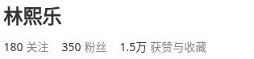
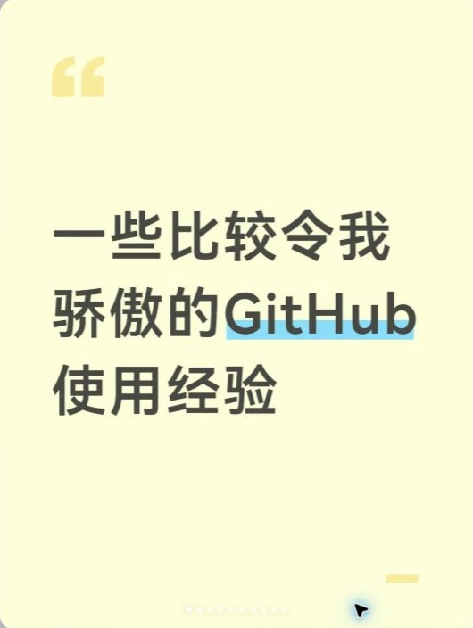
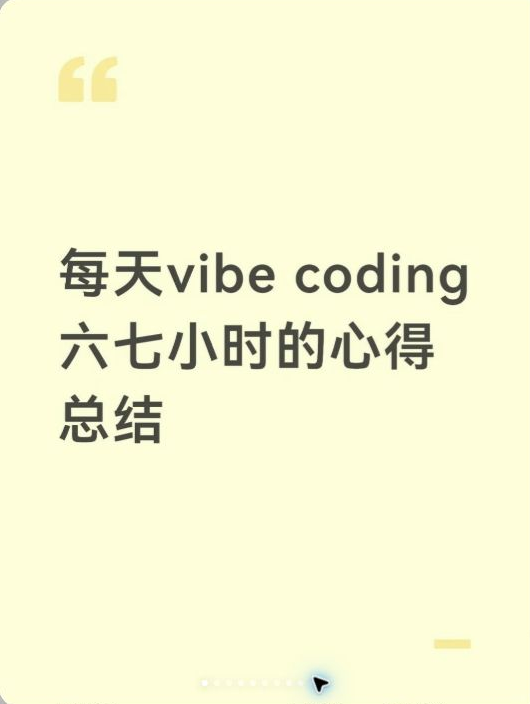
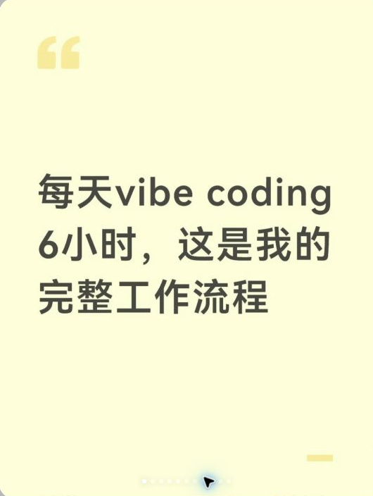

# 林熙乐（350 粉）

[⬅ 返回对标总览](../README.md) · [小红书主页原链](https://www.xiaohongshu.com/user/profile/68b92f5e000000001901d347)

---

## 一、已归档原帖

| 封面预览 | 标题（点击看原帖） | 赞 / 藏 / 评 | 页数 | 原图与原文状态 |
|---|---|---|---|---|
|  | [01_1794赞_github搞钱最快的方式](./01_1794赞_github搞钱最快的方式.md) | 1794 / 2337 / 28 | 10 页 | 已有封面图；**待补 P2～P10 原图与逐页原文、正文原文** |
|  | [02_1149赞_每天vibe-coding心得总结](./02_1149赞_每天vibe-coding心得总结.md) | 1149 / 1412 / 80 | 11 页 | 已有封面图；**待补 P2～P11 原图与逐页原文、正文原文** |
|  | 03_197赞_不会vibe coding都给我去看啊啊啊！so easy | 197 / 256 / 3 | 11 页 | P2～P11 内页与 02 相同，已合并记录在 02 中 |

---

## 二、主页其他可见笔记列表（2026-11-11 记录）

| 笔记标题 | 赞数 | 链接 |
|---|---:|---|
| 强烈推荐大家去听的6档财经播客 | 95 | https://www.xiaohongshu.com/explore/6ade2ec8000000002c03b7ab |
| 环境才是人生最大的奢侈品 | 42 | https://www.xiaohongshu.com/explore/6ad8bbc1000000003102d832 |
| 目前为止认为最简单高效的ai做ppt方法！ | 41 | https://www.xiaohongshu.com/explore/6ae346e7000000003402b76b |
