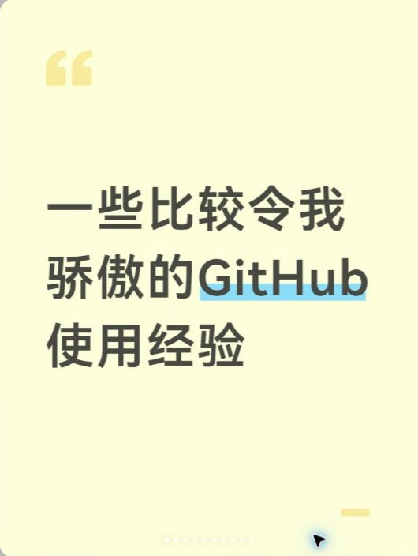

# 个人认为github搞钱最快的方式

[⬅ 返回林熙乐主页](./README.md) · [返回对标总览](../README.md) · [小红书原帖链接](https://www.xiaohongshu.com/explore/6ae0a523000000003501ebff)

---

## 一、基础数据与客观属性

| 属性 | 内容 |
|---|---|
| **博主 / 粉丝数** | 林熙乐（350 粉） |
| **互动数据** | 1794 赞 · 2337 藏 · 28 评（藏赞比 1.30） |
| **发布/编辑时间** | 页面显示编辑于 10-27（采集日 2026-11-11） |
| **形式与篇幅** | 图文（共 10 页文字卡片） |
| **标题 vs 封面文字** | **笔记标题**：`个人认为github搞钱最快的方式` **封面大字**：`一些比较令我骄傲的GitHub使用经验` |
| **选题主题** | 介绍如何把 GitHub 当作寻找真实用户痛点（Issues）和现成开源项目（Awesome/Skills）的入口，通过改造现有项目交付服务 |
| **叙事结构** | `P1 封面立题` → `P2 转换视角（看 Issue 不只看代码）` → `P3-P4 找项目的入口与筛需求标准` → `P5-P6 修改现成项目的案例叙事` → `P7-P8 常用 Skill 与开源项目清单` → `P9-P10 落地流程与行动建议` |
| **视觉版式特征** | 浅奶黄色背景，左上角双引号图标，右下角短横线；封面 `GitHub` 词带浅蓝色半高下划线高亮；内页纯文字分段+编号，无代码截图 |
| **文本风格特征** | 第二人称“你”直接叙述；口语化经验分享语气；通过具体场景（求职服务、自动化脚本）和项目名称清单组织信息 |

---

## 二、逐页图文内容记录（共 10 页）

> 说明：2026-11-11 首轮采集时仅保存了 P1 封面原图，P2～P10 为当时逐页阅读的完整内容记录（需要 P2～P10 原图和逐字文本时，可由 Codex 在本地浏览器按 `benchmark-collect` SOP 补存 `p02.png`～`p10.png`）。

| 页码 | 原图画面 | 该页文字与内容记录 | 页面结构角色 |
|---|---|---|---|
| **P1（封面）** |  | **封面原文**：「一些比较令我骄傲的 `GitHub` 使用经验」 | 封面页：以个人经验视角引出 GitHub 主题 |
| **P2** | *（待补 `p02.png`）* | 将阅读 GitHub 的关注点从“看代码与项目介绍”转向“看 Issue 区里的用户困难与抱怨” | 视角转换：提出去 Issue 区找痛点的切入点 |
| **P3** | *（待补 `p03.png`）* | 先按要解决的「任务用途」划分目标项目，给出两类查找入口： 1. `Awesome` 系列汇总清单 2. 具体项目的 `Issues` 区 | 方法步骤 1：给出查找入口 |
| **P4** | *（待补 `p04.png`）* | 讲解如何在 Issues 中按评论热度排序、识别多人重复提及的诉求；强调挑“有明确输入、输出、使用对象和具体场景”的小任务 | 方法步骤 2：给出筛选需求的标准 |
| **P5～P6** | *（待补 `p05-p06.png`）* | 从发现需求过渡到基于现成开源项目做二次修改；列举第三方求职辅助服务、自动化接单等交付叙事案例 | 案例展开：举例说明如何把开源项目变成可交付服务 |
| **P7～P8** | *（待补 `p07-p08.png`）* | 罗列一批具体的 Skill 与 GitHub 开源项目名称，每个项目配一句用途说明及 Star 数/安装量描述 | 资源清单页：提供可收藏的工具/项目列表 |
| **P9～P10** | *（待补 `p09-p10.png`）* | 汇总“找需求 → 找现成工具 → 修改交付 → 收费”的流程，结尾建议读者不要只收藏，先从自己工作里的一个具体烦恼动手试做 | 结尾收束：总结流程并给出下一步动作 |

---

## 三、评论区读者留言汇总（原文归类）

页面共显示 28 条评论（可见 10 条非作者主评）：

| 留言类型 | 条数 | 读者原话 / 核心问题记录 |
|---|---:|---|
| **索要项目/仓库地址** | 1 | 「给出文中提到的仓库地址」 |
| **询问选型（找现成 vs 自己写）** | 1 | 提出具体的 CRM 需求，询问应该在 GitHub 找现成项目改，还是直接用 Vibe Coding 从头写 |
| **询问如何学开发思路与架构** | 1 | 询问能不能通过看 GitHub 学到高手做软件的思路，表示自己不清楚怎么描述新增需求、怎么修改和组织架构 |
| **对实操难度的讨论** | 1 | 提出看懂项目、定位问题或提 Issue 的复杂度有时并不比自己重写低 |
| **其他（感谢/求更新/催更）** | 6 | 表达感谢、请求总结或催更后续内容 |
