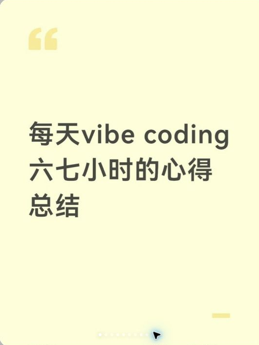

# [1149赞 vs 197赞] 每天 vibe coding 六七小时的心得总结（含天然 A/B 对照）

[⬅ 返回林熙乐主页卡](./README.md) · [返回对标总览](../README.md) · [1149赞原帖](https://www.xiaohongshu.com/explore/6adef93c000000000901b280) · [197赞对照帖](https://www.xiaohongshu.com/explore/6adeaa1c000000001801ba99)

---

## 一、📊 量化计分板（最经典的天然 A/B 测试）

这位博主把**完全相同的 10 页内页内容**发了两次，只换了封面大字和笔记标题，结果数据差了 **5.8 倍**：

| 版本 | 笔记标题 | 封面大字 | 点赞 | 收藏 | 评论 | 藏赞比 | 结果判定 |
|---|---|---|---:|---:|---:|---:|---|
| **A 版（爆款）** | **每天vibe coding六七小时的心得总结** | 每天vibe coding六七小时的心得总结 | **1149** | **1412** | 80 | **1.23** | 🔥 **大爆款（中位赞 16.8 倍）** |
| **B 版（对照）** | **不会vibe coding都给我去看啊啊啊！so easy** | 每天vibe coding 6小时，这是我的完整工作流程 | **197** | 256 | 3 | 1.30 | 😐 **数据缩水 83%** |

| A 版封面（1149 赞） | B 版封面（197 赞） |
|---|---|
|  |  |
|  |  |

---

## 二、🎯 核心启示：为什么一模一样的内容，换个标题差了近 6 倍？

1. **受众气场匹配**：
   - 会点开 `vibe coding`（AI 编程）的人，哪怕是新手，也希望看到**「真正在一线高强度折腾的人掏出来的干货」**。
   - A 版标题《每天vibe coding六七小时的心得总结》给人一种**“我替你们踩了上百个小时的坑，这是我的血泪笔记”**的真诚感；
   - B 版标题《不会vibe coding都给我去看啊啊啊！so easy》充满了廉价营销号的叫卖感，直接把真正想学做工具的读者劝退了。
2. **对我们账号的铁律**：
   - 我们的语气（[voice.md](../../rules/voice.md)）可以幽默、可以自嘲（比如“被 AI 包养”），但**绝不能用“都给我去看啊啊啊！太绝了！so easy”这种低幼咆哮体**。

---

## 三、🖼️ 逐页内容结构拆解（共 11 页文字卡）

| 页码 | 这一页讲了什么（内容与话术） | 为什么这样排？（结构意图） |
|---|---|---|
| **P1 封面** | **大字**：「每天vibe coding六七小时的心得总结」 | 用高强度投入时长（每天 6～7 小时）建立第一眼信任感 |
| **P2 破题** | 大家用的都是同一个 AI 模型（Claude / Cursor），为什么有人能做出完整产品，有人改两下代码就全崩？差别不在工具，在**动手前的工作流** | 先说读者最痛的共鸣点：**“Demo 十分钟跑通，一改需求全崩”** |
| **P3 个人翻车转折** | 讲自己一开始也是直接跟 AI 对话硬写，结果越改越乱、推倒重来；后来发现关键转折点是**先写需求与规则文档** | 用“我也翻过车”拉近距离，引出核心方法 |
| **P4～P5 怎么偷师** | 教大家去 GitHub 看成熟的开源项目是怎么组织文档、怎么写更新记录（Changelog）和规则文件的 | 给普通人一个现成的学习参照物 |
| **P6～P9 核心工作流（4页干货）** | 把 AI 编程拆成傻瓜式 6 步： 1. 先写清任务说明与边界（哪些不许改） 2. 让 AI 先出计划，人确认再写代码 3. 拆成小步任务，每步必须有可检查的标准 4. 改完立刻存档（Git commit） 5. 上下文脏了果断重开对话 6. 把常犯的错沉淀进固定的规则模板（如 `CLAUDE.md` / `AGENTS.md`） | **全篇收藏率最高的核心区**：这其实就是你平时用 Claude/Codex 管集群、写 `todoulist` 每天真正在做的事！普通人极其缺这套流程 |
| **P10～P11 结尾降门槛** | 别等把所有技术学完再动手，先挑一个最小的任务跑通这套流程，存下你自己的第一份模板 | 降低行动门槛，鼓励读者先跑起来 |

---

## 四、💬 评论区大家在问什么？（80 条评论里的真痛点）

1. **“每天写六七个小时，你到底做出了什么成品？能看看吗？”**
   - 👉 **这是林熙乐最大的短板，却正好是你最大的优势！** 他全是纯文字卡片，拿不出真正在跑的产品界面；而你有真实的 **个人数据库（健身+理财+学习）**、有 **todoulist Mac 原生应用**、有 **网站监控工具**！
2. **“每次让 AI 写了一半才发现 GitHub 上早就有现成的了，白花了一堆 Token 钱”**
   - 👉 读者痛点：开工前不知道怎么让 AI 先做调研。

---

## 五、💡 我们怎么拿这节课抄作业？

这篇讲的「先定规则文档 → 拆小步 → 验收脚本 → 沉淀记忆」**完完全全就是你在 `~/readme` 和 `todoulist` 里每天实操的东西**，而且你有真凭实据！

可以直接出一篇 **《让 AI 给我写了上万行代码后，我只留了这 5 条规矩》**（或放进「小白造工具」系列）：
- 不仅讲清这几步（不许直接改代码、先出计划、写检查脚本兜底），而且**直接晒出你真实的 `agent-standard.md` 规则卡片和做出来的 `todoulist` 界面**——既有他的流程收藏价值，又补上了他拿不出真实作品的短板。
