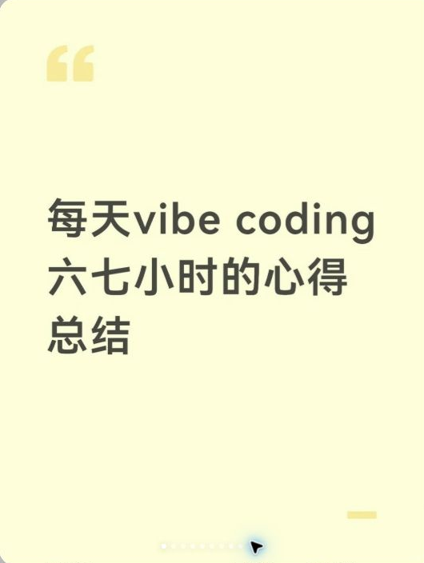

# 对标博主：林熙乐（350 粉小号连出两篇千赞爆款）

[⬅ 返回对标库总览](../README.md) · [小红书主页原链](https://www.xiaohongshu.com/user/profile/68b92f5e000000001901d347)

---

## 一、账号量化画像

| 指标 | 数值 | 对我们的参考意义 |
|---|---|---|
| **粉丝量** | **350**（新号起步档） | 证明没有粉丝基础的新号，靠单篇结构就能撬动千赞万次曝光 |
| **主页近 8 篇中位赞** | **68.5 赞** | 平时普通帖在 40～95 赞之间 |
| **最高爆款** | **1794 赞 / 2337 藏**（中位数的 **26 倍**） | 极强的冷启动爆款能力，且**收藏远高于点赞（藏赞比 1.30）** |
| **内容形式** | **10～11 页纯文字卡片** | 零拍摄成本、零复杂配图，全靠卡片排版和文案节奏 |
| **对标我们哪个系列** | **给自己造工具 / 小白造工具** | 把程序员手里的工具（GitHub、AI 编程）翻译成普通人能懂的用途 |

---

## 二、三篇代表作视觉与数据并排对比（一眼看懂他为什么火）

| 爆款 1（1794 赞 / 2337 藏） | 爆款 2（1149 赞 / 1412 藏） | 对照组：同内容换标题（仅 197 赞） |
|---|---|---|
|  |  |  |
|  |  |  |
| **标题**：个人认为github搞钱最快的方式 | **标题**：每天vibe coding六七小时的心得总结 | **标题**：不会vibe coding都给我去看啊啊啊！so easy |
| **封面字**：一些比较令我骄傲的GitHub使用经验 | **封面字**：每天vibe coding六七小时的心得总结 | **封面字**：每天vibe coding 6小时，这是我的完整工作流程 |
| 👉 [点此看单篇拆解卡](./01_1794赞_github搞钱最快的方式.md) | 👉 [点此看单篇拆解卡](./02_1149赞_每天vibe-coding心得总结.md) | （与左篇内页 10 页完全相同，见左篇对比） |

---

## 三、主页爆款 vs 普通帖对比表（为什么有的火、有的扑？）

| 分类 | 笔记标题 | 点赞 | 倍数（相对中位 68.5） | 为什么火 / 为什么扑？ |
|---|---|---:|---:|---|
| 🔥 **爆款 1** | [个人认为github搞钱最快的方式](./01_1794赞_github搞钱最快的方式.md) | **1794** | **26.2x** | **神级反差**：把“程序员看代码的网站”翻译成“普通人找赚钱需求的宝库”，封面稳重、标题直接给利益 |
| 🔥 **爆款 2** | [每天vibe coding六七小时的心得总结](./02_1149赞_每天vibe-coding心得总结.md) | **1149** | **16.8x** | **重度玩家背书**：“每天六七小时”直接建立实战感，吸引所有正在用 AI 写代码但经常翻车的人 |
| ⚖️ **同文对照** | 不会vibe coding都给我去看啊啊啊！so easy | **197** | 2.9x | **内页 10 张图跟上一篇一模一样，但赞数少了 83%！** 因为标题像低幼营销号，劝退了真正想学做工具的人 |
| 😐 **普通帖 1** | 强烈推荐大家去听的6档财经播客 | 95 | 1.4x | 偏离 AI 造工具主线，泛财经书单竞争太大 |
| 😐 **普通帖 2** | 环境才是人生最大的奢侈品 | 42 | 0.6x | 纯个人鸡汤感悟，小号没人关心你的生活感悟 |
| 😐 **普通帖 3** | 目前为止认为最简单高效的ai做ppt方法！ | 41 | 0.6x | “AI 做 PPT”已经烂大街，标题没有新鲜视角，也没有独特人设背书 |

---

## 四、我们可以直接抄他的 3 个方法

### 1. 视觉模板：极低成本的「奶黄底大字卡」
- **背景**：护眼浅奶黄色（`#FFFCE6` 左右），左上角一个浅黄双引号 `“`，右下角一个短横线 `—`。
- **字体与高亮**：深灰/纯黑无衬线粗体大字，居中偏左排布；**全封面的核心关键词（如 `GitHub`）加一条天蓝色半高底色高亮条**。
- **好处**：不需要找配图、不需要设计功底，滑动时阅读速度极快，账号主页整整齐齐。

### 2. 标题与封面的「双轨法则」
- 当你想写一个稍微带点功利心或强吸引力的题目时：**把“俗但抓人”的话放进笔记标题，把“真诚、体面、有经验感”的话放进封面大字**（参考他的爆款 1）。

### 3. 内页叙事公式：「颠覆常识 → 具体入口 → 防坑工作流」
- **前 2 页**：先否定大家的常规做法（*“你以为去 GitHub 是看代码的？错，是去看 Issue 区谁在抱怨没工具用的”*）。
- **第 3～6 页**：给普通人能照着点的入口（比如看哪个标签、按什么排序）。
- **第 7～10 页**：给一套「一步步怎么做」的流程清单，让人忍不住点收藏慢慢看。
