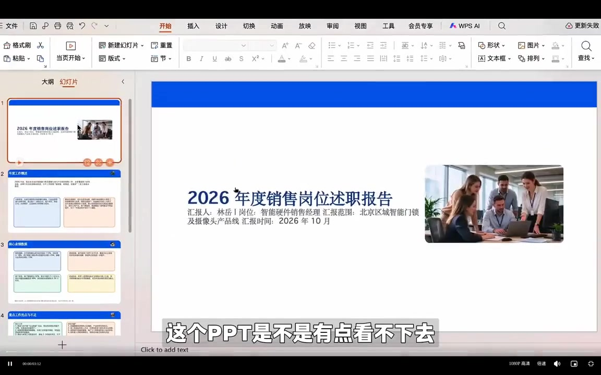
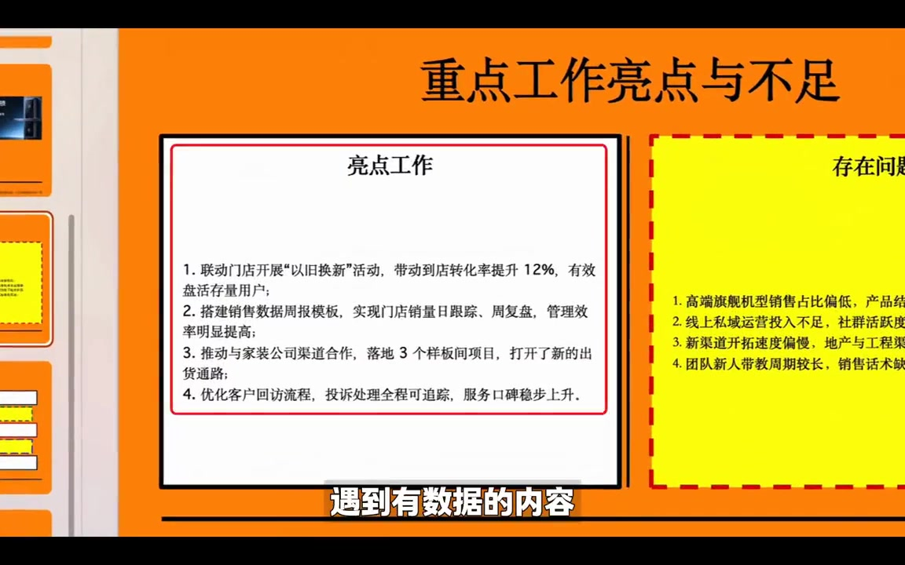
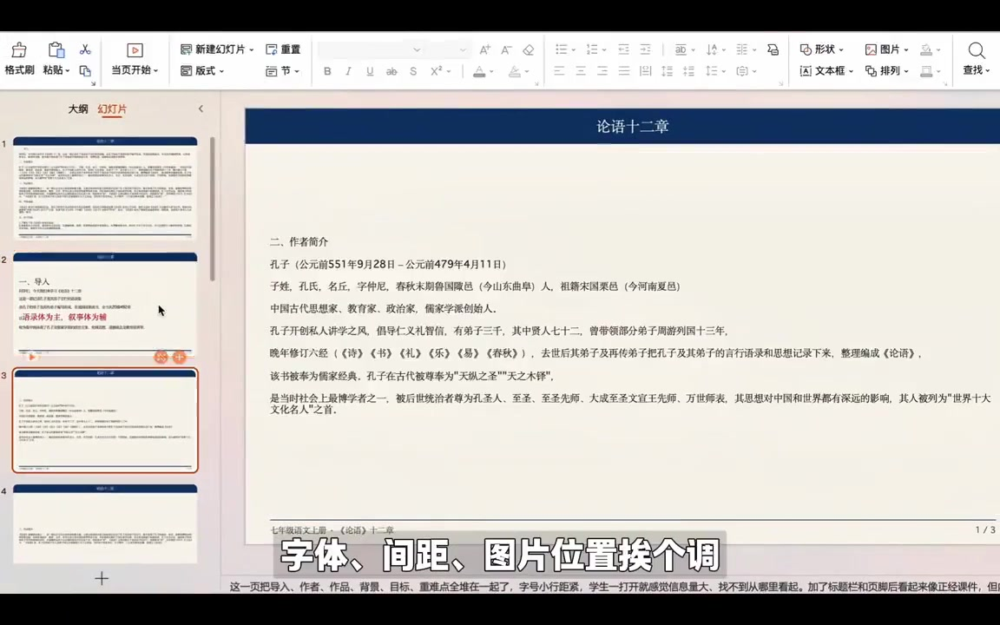
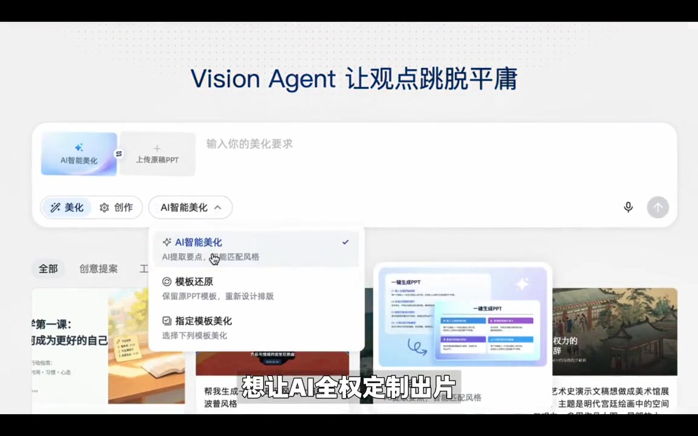
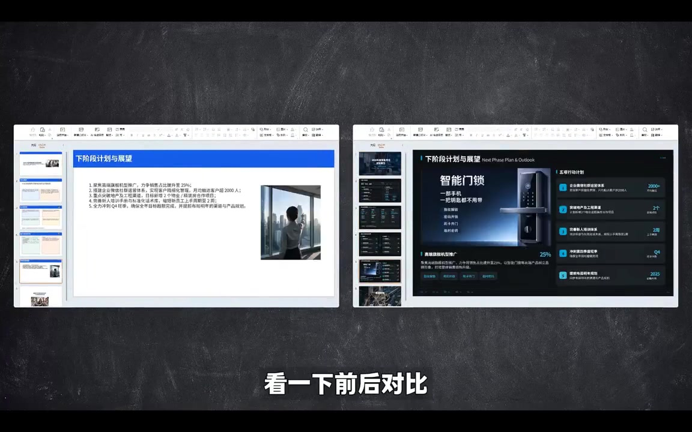
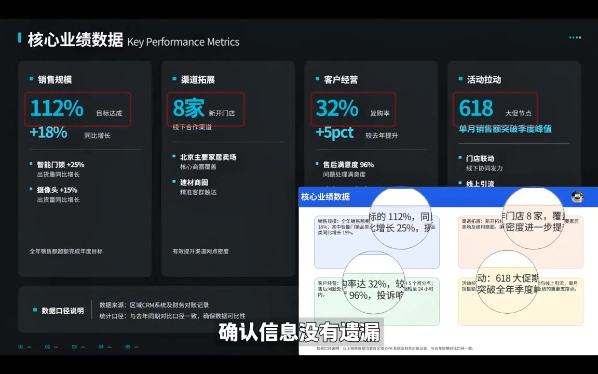
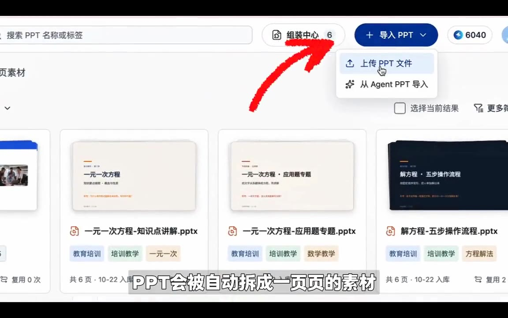

# 做出来的PPT很丑？没事，AI一键变好看

[⬅ 返回博主主页](./README.md) · [返回对标总览](../README.md) · [小红书原帖](https://www.xiaohongshu.com/explore/6ae8128e0000000003008ce2)

- **作者**：老麦的工具库（96.5万粉，小红书号 574806195）
- **主页**：[老麦的工具库](https://www.xiaohongshu.com/user/profile/5e1022d2000000000100395d)
- **简介**：北漂8年，前字节、百度员工；专注效率利器、AI技术、自媒体神器；发誓把库里的1000个工具更新完
- **时间**：11-03 北京
- **数据**：699 赞 · 935 藏 · 20 评
- **形式**：视频 03:12，录屏
- **声明**：含ai生成内容

做出来的PPT很丑？没事，AI一键变好看

#ppt #讯飞智文 #AIPPT #AI生成PPT #PPT技巧

录屏：[assets/01/screen-recording.mp4](assets/01/screen-recording.mp4)

## 口播

| 时间 | 画面 | 口播 |
|---|---|---|
| 00:00–00:18 |  | 这个PPT是不是有点看不下去？每页的文字虽然都放好了，但要审美没审美，要排版没排版。别着急删，直接上传讯飞智文，只需要说出你的美化要求，然后PPT就可以瞬间改头换面。排版布局、配色、字体调整，全都完成美化。 |
| 00:18–00:40 |  | 做过PPT的打工人知道，内容明明已经写完了，还得花几个小时排版美化。标题多大？图片放哪？重点怎么突出？改来改去还是不好看。遇到有数据的内容，还得想用什么图表呈现，一步步调整。结果领导来了一句：“可以再高级一点。”又得重新找模板、换配色。挪版式，光排版就得折腾到半夜。 |
| 00:40–01:05 |  | 其实这时要的不是重做，是有人帮你在现有内容上把设计重排一遍。不仅是职场了，教师、企业培训师应该都很懂这种痛苦。课件一打开全是字，重点不突出，学生看着也累。几十页下来，字体、间距、图片位置挨个调，调到最后自己都看麻了。来给大家看一下，我写的季度述职汇报PPT。 |
| 01:05–01:27 |  | 这里我已经把每页的内容写好了，包括工作回顾、项目成果、和下一阶段计划等等。但页面基本就是文字堆在一起，业绩数据不突出，几张图片放进去也很随意。我们打开讯飞智文，点击Vision Agent切换到“美化”。它有三种模式可以选。如果你懒得设计，想让AI全权定制出片，可以选“AI智能美化”；要是你不想换模板，只想理顺重点，那“模板还原”就很合适。 |
| 01:27–01:55 |  | 如果没灵感，但有喜欢的风格，那可以去灵感集挑一挑，用“指定模板美化”。我这里选第三种，直接上传文件，挑个喜欢的风格，再把要求说清楚。来，咱们把原版和美化版放在一起，看一下前后对比。封面的述职主题、姓名和时间拉开了层级；原来挤在一起的工作回顾被重新分区；到了项目结果页，关键数字被放大，图片和对应说明也能一眼看清。述职PPT最重要的就是让领导快速看清：我做了什么、取得什么结果。美化也应该围绕这个目的。 |
| 01:55–02:25 |  | 讯飞智文会给这些内容建立清晰的阅读顺序，再对照原稿核对文字和数字，确认信息没有遗漏，把关键业绩数字放大突出。这种PPT才算改到位了。如果你经常要做PPT，这里还有个很实用的功能：演示资产库。它能帮你打造个人专属素材库，我发现它用起来很省心。比如老师要做学期复习，上学期讲过的知识点、例题和操作步骤，可能散落在不同课件里。以前要挨个打开文件，翻找内容、手动复制、调整细节。 |
| 02:25–03:12 |  | 现在导入讯飞智文资产库后，PPT会被自动拆成一页页的素材。你只需要输入关键词，一搜就能找到。跨着几份PPT，也能直接勾选要用的页面，像搭积木一样拼新稿。再也不用从第一页重新做，想先讲哪页后讲哪页，拖一拖它就给你排好了。你看，原来分散在不同PPT里的内容，被重新整理成了一套完整课件。该保留的内容还在，页面风格也统一了。过去攒下的内容一次沉淀就能反复取用，真正变成了自己的资产。而且PPT美化、演示资产库，这些现在都是「免费使用」，感兴趣可以直接上手试试。  其实不管是老师、培训师还是职场打工人，大家真正擅长的是自己的专业内容。做PPT设计反而成了额外负担。既然讯飞智文能把已有的内容美化，整理和PPT复用也都能搞定，我们就能把更多精力放回内容准备上了。这才是AI该给我们带来的效率提升。 |

[风格与提示词](./01_699赞_做出来的PPT很丑没事AI一键变好看_风格与拟定提示词.md)

## 评论

读者原话和作者回复。点点的总结单独放在文末，不算读者评论。

- **不加班的牛马PPT**（11-05 广西，4赞）：「怎么用呢，求分享」
  - **老麦的工具库**（11-05 北京）：「就叫讯飞智文，传你的ppt就去就行，它都能美化」
  - **不加班的牛马PPT**（11-05 广西）：「这个讯飞智文是APP吗」
  - **老麦的工具库**（11-05 北京）：「网站」
  - **不加班的牛马PPT**（11-05 广西）：「可以分享网址吗」
- **想退休。**（11-03 广东，1赞）：「你咋知道我ppt做的丑」
  - **momo**（11-05 北京）：「+1」
- **海月沣芳**（11-06 浙江，1赞）：「收费吗」
  - **老麦的工具库**（11-06 北京）：「免费」
- **无敌**（7天前 上海）：「本来还挺正常的，一弄成这样子一眼ai，不被老师骂死」
- **小红薯321**（11-05 广西，5赞）：「夸大了AI的作用，AI做的PPT更丑。」
- **时代的发展**（11-03 北京，1赞）：「这个是免费的吗」
  - **老麦的工具库**（11-03 北京）：「是的」
- **AI工具箱**（11-05 广东）：「前后对比这张封面比长教程好懂。我改季度计划时会先锁住标题层级和数字，只把配色、间距和图标交给生成，丑稿不用整页推倒。图表页容易把字号压太小，你们一般会再手动收一轮吗？」
- **momo**（11-03 北京，1赞）：「只有大白底的ppt也可以优化吗」
  - **老麦的工具库**（11-03 北京）：「当然」

全部 20 条（11 条一级，9 条回复）

- **不加班的牛马PPT**（11-05 广西，4赞）：「怎么用呢，求分享」
  - **老麦的工具库**（11-05 北京）：「就叫讯飞智文，传你的ppt就去就行，它都能美化」
  - **不加班的牛马PPT**（11-05 广西）：「这个讯飞智文是APP吗」
  - **老麦的工具库**（11-05 北京）：「网站」
  - **不加班的牛马PPT**（11-05 广西）：「可以分享网址吗」
- **想退休。**（11-03 广东，1赞）：「你咋知道我ppt做的丑」
  - **momo**（11-05 北京）：「+1」
- **海月沣芳**（11-06 浙江，1赞）：「收费吗」
  - **老麦的工具库**（11-06 北京）：「免费」
- **无敌**（7天前 上海）：「本来还挺正常的，一弄成这样子一眼ai，不被老师骂死」
- **小红薯321**（11-05 广西，5赞）：「夸大了AI的作用，AI做的PPT更丑。」
- **时代的发展**（11-03 北京，1赞）：「这个是免费的吗」
  - **老麦的工具库**（11-03 北京）：「是的」
- **陈春11111**（11-04 江苏）：「缘分刷到这里」
- **AI工具箱**（11-05 广东）：「前后对比这张封面比长教程好懂。我改季度计划时会先锁住标题层级和数字，只把配色、间距和图标交给生成，丑稿不用整页推倒。图表页容易把字号压太小，你们一般会再手动收一轮吗？」
- **momo**（11-03 北京，1赞）：「只有大白底的ppt也可以优化吗」
  - **老麦的工具库**（11-03 北京）：「当然」
- **睇睇唔**（11-03 山东）：一枚图片/表情，没有可辨文字。
- **AI来鸿**（语文与世界，11-05 广东，1赞）：「@点点 总结视频内容」
  - **点点**（AI总结，11-05）：这个视频讲的是如何用 讯飞智文 的 AI 功能快速美化 PPT，解决"内容写好了但排版丑、花几个小时调还是不好看"的痛点。
【核心功能演示】
AI 一键美化：上传 PPT 后点击"Vision Agent"切换到美化模式，有三种可选方式——AI 智能美化（全权定制）、模板还原（不换模板只捋重点）、指定风格美化（从灵感集挑风格）。AI 会自动调整排版、配色、重点突出，比如把关键业绩数字放大、重新分区内容、建立清晰的阅读顺序。
演示资产库：可以把过往 PPT 导入资产库，自动拆成单页素材，通过关键词搜索跨文件复用内容，像搭积木一样拼出新稿，不用从头再做。
【适用人群】
职场打工人（述职汇报）、教师（课件制作）、企业培训师等需要频繁做 PPT 的场景。
视频最后提到美化、资产库等功能目前免费使用。评论区有人反馈 AI 做的 PPT 效果不一定理想，也有人觉得工具确实省心，整体评价偏中性。

