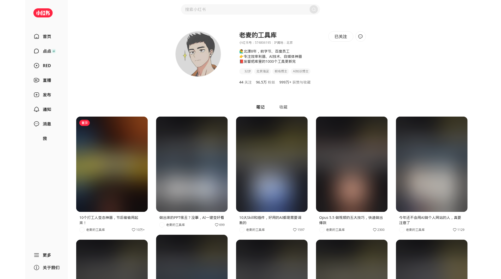

# 老麦的工具库（96.5万 粉）

[⬅ 返回对标总览](../README.md) · [小红书主页](https://www.xiaohongshu.com/user/profile/5e1022d2000000000100395d)

小红书号 574806195。96.5万粉。简介：北漂8年，前字节、百度员工；专注效率利器、AI技术、自媒体神器；发誓把库里的1000个工具更新完。

评论页截图：[assets/01/comments.png](assets/01/comments.png)

## 已归档笔记

| 标题 | 帖子 | 赞 / 藏 / 评 | 形式 |
|---|---|---|---|
| 做出来的PPT很丑？没事，AI一键变好看 | [01_699赞_做出来的PPT很丑没事AI一键变好看](./01_699赞_做出来的PPT很丑没事AI一键变好看.md) · [风格与提示词](./01_699赞_做出来的PPT很丑没事AI一键变好看_风格与拟定提示词.md) | 699 / 935 / 20 | 视频 03:12，录屏 |
