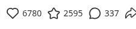
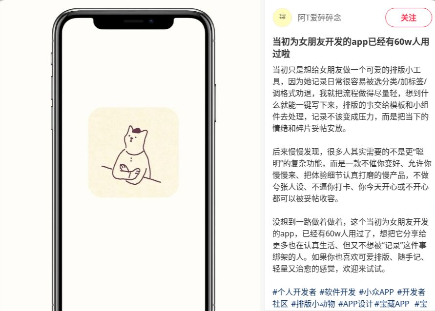
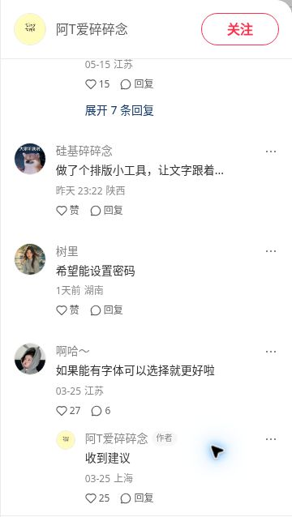

# 当初为女朋友开发的app已经有60w人用过啦

[⬅ 返回阿T主页](./README.md) · [返回对标总览](../README.md) · [小红书原帖链接](https://www.xiaohongshu.com/explore/69c266100000000022026bbe)

---

## 一、基础数据

- **作者**：阿T爱碎碎念（4183 粉）
- **数据**：6780 赞 · 2595 藏 · 337 评
- **时间**：编辑于 04-01
- **形式**：图文（共 6 页，首图含动效）

---

## 二、首图与正文原画面截图

> **【待 Codex 补采 P2～P6】**：需补存 `assets/01/p02.png`～`p06.png` 及图上文字。

---

## 三、评论区原始截图与留言摘录

| 评论截图 1 | 评论截图 2 |
|---|---|
|  |  |

- 「免费的吗」 / 「我也想问！」
- 「输入的内容有安全性吗…写的东西不会在后台一览无遗吧」
- 「希望能设置密码」
- 「如果能有字体可以选择就更好啦」
- 「安卓强烈建议」
- 「图片只能添加1张，能不能多加几张呀」 / 「我希望每篇都可以放很多图片！」
